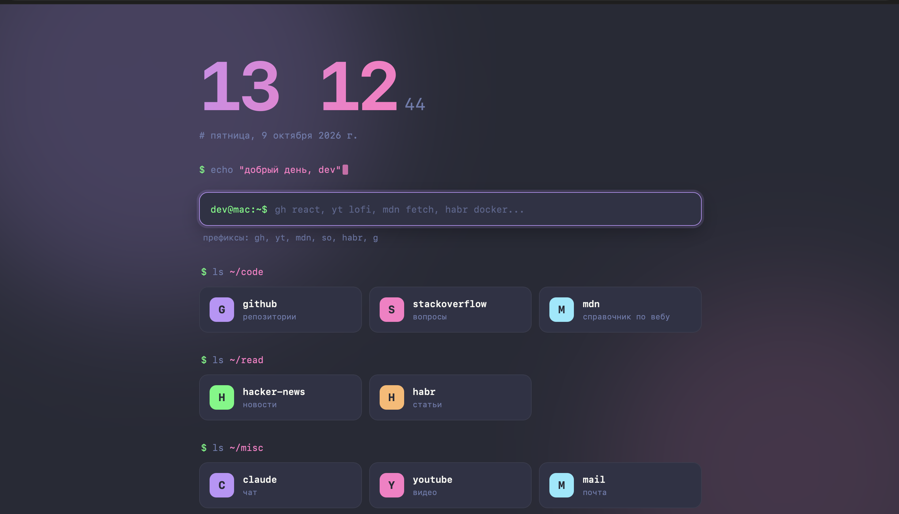

# startpage

Стартовая страница для браузера в стиле терминала: тёмная тема Dracula, большие часы, поиск с префиксами и подсказками как в Google, быстрые ссылки в виде карточек. Без сборки, без зависимостей и без сервера: достаточно трёх вещей, HTML, CSS и JavaScript.

<!-- Положи скриншот в docs/screenshot.png и раскомментируй строку ниже

-->

## Возможности

- **Часы и дата** с мягкой анимацией, приветствие по времени суток.
- **Поиск с префиксами**: `gh react`, `yt lofi`, `mdn fetch`, `so promise`, `habr docker`. Текст без префикса уходит в Google, а `example.com` открывается как адрес.
- **Подсказки как в Google**: сначала ваши ярлыки, затем подсказки Google (с запасным вариантом DuckDuckGo). Работает со стрелками, `Tab`, `Enter`, `Esc` и мышью.
- **Карточки быстрых ссылок**, сгруппированные по «папкам» (`~/code`, `~/read`, ...), с анимацией при наведении.
- **Всё настраивается в одном файле**: [`js/config.js`](js/config.js).
- Учитывает системную настройку «Уменьшить движение».

## Быстрый старт (Safari на Mac)

1. Скачайте проект в постоянную папку, например в `~/startpage`:

   ```bash
   git clone https://github.com/<ваш-логин>/startpage.git ~/startpage
   ```

   Либо скачайте ZIP со страницы репозитория и распакуйте его в `~/startpage`.

2. Откройте **Safari → Настройки → Основные** (или `⌘ ,`).

3. В поле **«Домашняя страница»** вставьте адрес файла:

   ```
   file:///Users/ИМЯ_ПОЛЬЗОВАТЕЛЯ/startpage/index.html
   ```

   Подсказка: перетащите `index.html` в окно Safari и скопируйте адрес из строки браузера.

4. В списках **«В новых окнах открывать»** и **«В новых вкладках открывать»** выберите **«Домашнюю страницу»**.
   Пункт «Начальную страницу» — это встроенная страница Safari, а не ваша.

5. Откройте новую вкладку (`⌘T`).

> Перенос папки или переименование ломает путь в настройках Safari. Положите проект в постоянное место.

## Другие браузеры

Страница обычная, поэтому работает в любом браузере, если открыть `index.html`. Но способ сделать её стартовой разный:

| Браузер | Как использовать |
|---|---|
| Safari | Домашняя страница + «Новые окна/вкладки открывать: Домашнюю страницу» (см. выше) |
| Firefox | Настройки → Домашняя страница → «Свои адреса», вставьте адрес файла |
| Chrome, Edge | Локальный файл нельзя назначить новой вкладкой без расширения. Можно назначить как страницу при запуске, либо воспользоваться хостингом (см. ниже) |

### Размещение на GitHub Pages (необязательно)

Если хотите открывать страницу по обычному адресу, а не как локальный файл:

1. В репозитории откройте **Settings → Pages**.
2. В разделе Source выберите ветку `main` и папку `/ (root)`.
3. Через минуту страница появится по адресу `https://<ваш-логин>.github.io/startpage/`.
4. Этот адрес можно указать как домашнюю страницу в браузере.

Учтите: ваш список ссылок станет публично виден, если репозиторий публичный.

## Настройка

Все пользовательские настройки находятся в [`js/config.js`](js/config.js). После правки обновите страницу (`⌘R`).

### Имя и язык

```js
user: 'dev',        // имя в приглашении и приветствии
host: 'mac',        // «имя компьютера» в приглашении
locale: 'ru-RU',    // формат даты
lang: 'ru',         // язык подсказок
```

### Быстрые ссылки

Формат: `'папка': [['название', 'адрес', 'подпись'], ...]`. Подпись необязательна: вместо неё покажется адрес сайта.

```js
links: {
  '~/work': [
    ['github', 'https://github.com', 'репозитории'],
    ['jira', 'https://example.atlassian.net']
  ]
}
```

### Поисковики и префиксы

Формат: `ключ: ['название', 'адрес поиска']`. Запрос подставляется в конец адреса.

```js
engines: {
  gh: ['GitHub', 'https://github.com/search?q='],
  npm: ['npm', 'https://www.npmjs.com/search?q=']
}
```

После этого `npm express` ищет на npmjs.com. Поисковик по умолчанию задаётся в `defaultEngine`.

### Подсказки

```js
suggestions: {
  providers: ['google', 'duckduckgo'],  // порядок опроса; первый ответивший побеждает
  max: 7,                               // сколько подсказок показывать
  debounceMs: 120,                      // пауза после ввода перед запросом
  timeoutMs: 2000                       // сколько ждать ответа провайдера
}
```

### Цвета и шрифты

Палитра, шрифт и тайминги анимаций лежат в [`css/tokens.css`](css/tokens.css). Чтобы сменить тему, достаточно поменять переменные `--bg`, `--panel`, `--purple` и остальные.

## Горячие клавиши

| Клавиша | Действие |
|---|---|
| Любая буква или `/` | Фокус в строку поиска |
| `↑` `↓` | Выбор подсказки |
| `Enter` | Открыть введённое или выбранную подсказку |
| `Tab` | Вставить выбранную подсказку в строку, не открывая |
| `Esc` | Закрыть список подсказок |

## Приватность

- Страница работает локально и ничего не собирает.
- Единственные сетевые запросы: текст, который вы печатаете в поиске, отправляется провайдерам подсказок (Google, затем DuckDuckGo), чтобы получить варианты.
- Чтобы отключить внешние подсказки, оставьте только свои ярлыки:

  ```js
  suggestions: { providers: [], max: 7, debounceMs: 120, timeoutMs: 2000 }
  ```

## Устранение неполадок

**Открывается обычная страница Safari с «Избранным».**
В настройках в списках «В новых окнах открывать» и «В новых вкладках открывать» должно быть **«Домашнюю страницу»**, а не «Начальную страницу». Уже открытые вкладки не обновятся: откройте новую.

**Пустая страница или ошибка «не удаётся открыть файл».**
Проверьте путь. В Терминале команда `ls ~/startpage/index.html` должна вывести путь к файлу. Адрес в Safari начинается с `file:///` (три слэша).

**Нет подсказок, видны только ярлыки.**
Подсказки запрашиваются из интернета. Проверьте соединение. Если сервисы заблокированы в вашей сети, страница работает и без них: ярлыки и поиск остаются.

**Страница выглядит «сломанной» (нет стилей или не работают скрипты).**
Скопируйте папку целиком: `index.html`, `css/` и `js/` должны лежать рядом. Ошибки видны в консоли: Safari → Разработка → Показать консоль JavaScript (включается в Настройки → Дополнения → «Показывать меню "Разработка"»).

**Шрифт не такой, как на скриншотах.**
Страница использует `JetBrains Mono` или `Fira Code`, если они установлены, иначе системный моноширинный шрифт (`SF Mono`, `Menlo`). Установите нужный шрифт или поменяйте `--font` в `css/tokens.css`.

## Структура проекта

```
startpage/
├── index.html              разметка и порядок подключения файлов
├── css/
│   ├── tokens.css          цвета, шрифты, тайминги
│   ├── base.css            сброс, раскладка, фон, общие анимации
│   └── components/         по одному файлу на блок страницы
├── js/
│   ├── namespace.js        ядро: реестр фич и шина событий
│   ├── config.js           все пользовательские настройки
│   ├── lib/                dom.js, jsonp.js
│   ├── providers/          источники подсказок (google.js, duckduckgo.js)
│   ├── features/           clock, greeting, links, search, suggestions
│   └── app.js              запускает все фичи
└── README.md
```

### Как это устроено

- **Одна фича, один файл.** Каждая возможность регистрируется через `StartPage.register(name, init)` и не вызывает другие фичи напрямую.
- **Связь через события.** Например, `search.js` сообщает `search:input`, а `suggestions.js` на это реагирует. Их можно менять независимо.
- **Сбой изолирован.** Если одна фича упала, остальные продолжают работать.
- **Почему не ES-модули.** Из `file://` браузеры не загружают `import`/`export`, поэтому используются обычные скрипты и пространство имён `StartPage`. Порядок подключения задан в конце `index.html`.

## Расширение

### Добавить фичу (например, погоду)

1. Добавьте контейнер в `index.html`.
2. Создайте `js/features/weather.js`:

   ```js
   StartPage.register('weather', function (app) {
     const { $ } = app.dom;
     $('weather').textContent = 'ясно, +18';
   });
   ```

3. При необходимости добавьте `css/components/weather.css`.
4. Подключите файлы в `index.html` перед `js/app.js`.

Внутри `init(app)` доступны: `app.config` (настройки), `app.dom` (`$` и `el`), `app.bus` (события), `app.features` (API ранее запущенных фич).

### Добавить источник подсказок

1. Создайте `js/providers/bing.js`:

   ```js
   StartPage.providers.push({
     id: 'bing',
     // query - текст запроса; ctx = { engine, lang, timeout }
     // нужно вернуть Promise со списком строк
     fetch(query, ctx) {
       return StartPage.jsonp(cb => 'https://example.com/suggest?q=' + encodeURIComponent(query) + '&callback=' + cb, ctx.timeout)
         .then(data => data.suggestions);
     }
   });
   ```

2. Подключите файл в `index.html` перед `js/features/suggestions.js`.
3. Добавьте `'bing'` в `suggestions.providers` в `js/config.js`.

Запросы идут через JSONP (`StartPage.jsonp`), потому что страница открыта как локальный файл и обычный `fetch` к чужим сайтам браузер блокирует.

## Совместимость

Основной целевой браузер: Safari на macOS. Нужен современный браузер с поддержкой CSS Grid, CSS-переменных и ES2017+ (подойдут актуальные Safari, Firefox, Chrome).

## Вклад в проект

Идеи и правки приветствуются: создайте Issue или Pull Request. Для новых возможностей следуйте структуре «одна фича, один файл» и добавляйте настройки в `js/config.js`.

## Лицензия

Добавьте файл `LICENSE` на свой выбор (например, MIT) и укажите его здесь.
